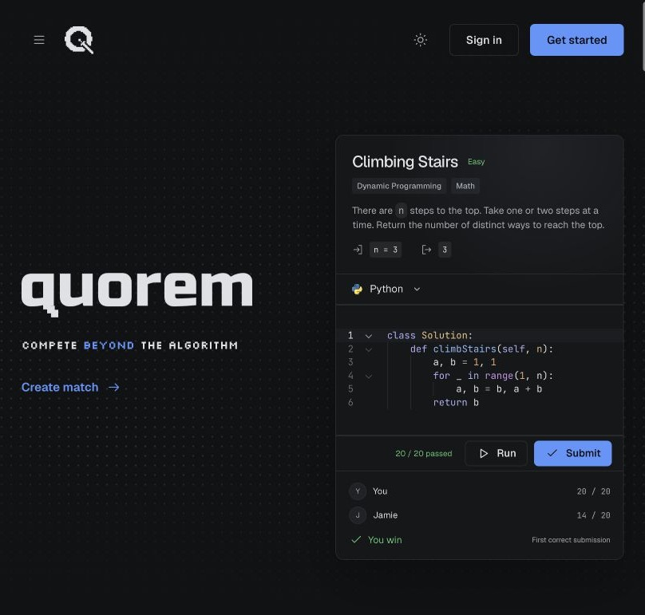
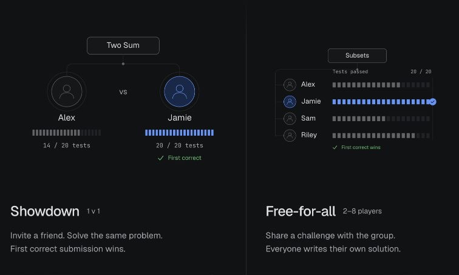
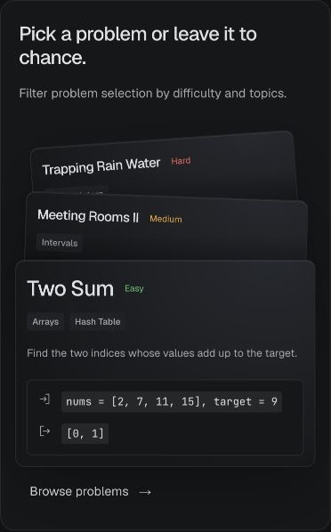
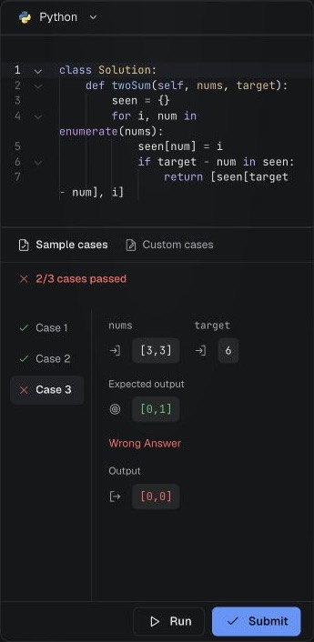

<a id="readme-top"></a>

<div align="center">

<picture>
  <source media="(prefers-color-scheme: dark)" srcset="apps/web/public/favicon-dark.svg" />
  
</picture>

<h1>Quorem</h1>

<strong>Compete beyond the algorithm.</strong>

Practice solo. Challenge friends. Code together in interviews.

<p>
  <a href="https://quorem.app"><strong>Try Quorem</strong></a> ·
  <a href="https://quorem.app/practice">Browse problems</a> ·
  <a href="https://github.com/ethan-ngai/quorem/issues">Report a bug</a>
</p>


[](LICENSE)

</div>

[](https://quorem.app)

## Contents

- [About the project](#about-the-project)
- [Features](#features)
- [Run locally](#run-locally)
- [Documentation](#documentation)
- [Contributing](#contributing)
- [License](#license)

## About the project

Quorem brings coding practice and private competition into one workspace. Pick a problem, invite a friend or group, and race for the first correct submission. Everyone writes their own solution; the match tracks results without sharing opponents' code.

The repository also includes solo practice, collaborative interviews, question authoring, and isolated judging for **Python, Java, TypeScript, OCaml, and PostgreSQL**.

Start at **[quorem.app](https://quorem.app)**. Create an account to run and submit in solo practice, or [create a private match](https://quorem.app/practice?create=match).

## Features

### One challenge. Independent solutions.

**Showdown** pairs two players. **Free-for-all** brings 2–8 players into the same challenge. Choose a specific problem or a filtered random selection, set the duration and lobby rules, then share an invitation. The first correct submission wins; at the deadline, passed tests decide the result, with ties drawing.



### Find a problem. Make the solution yours.

<table>
  <tr>
    <td width="50%" valign="top">
      
      <br /><strong>Practice with purpose</strong>
      <br />Browse by difficulty, topics, companies and question type. Work through algorithmic, SQL and progressive Odyssey questions.
    </td>
    <td width="50%" valign="top">
      
      <br /><strong>Test before you submit</strong>
      <br />Switch languages, try custom cases, and inspect results beside your code. Browser drafts preserve your work; light and dark themes suit your workspace.
    </td>
  </tr>
</table>

*Images captured from the live [Quorem marketing site](https://quorem.app); previews use illustrative problems and players.*

### Interview and author in the same workspace

- **Collaborative interviews:** share an editor with a candidate, run solutions, and advance Odyssey stages under interviewer control. Interviewer-private tests stay private.
- **Progressive questions:** Odyssey extends a problem across stages, adding requirements and methods as you progress.
- **Question libraries:** authorized authors create coding or SQL questions with structured signatures, examples, hidden tests and editorials. Publish versioned questions to global or private libraries.
- **Isolated judging:** submitted code runs in bounded sandboxes. SQL cases use isolated PostgreSQL instances and a restricted query role.

Hosting, guest admission and authoring depend on account permissions. See [guest access](docs/implementation/guest-access.md) and [question authoring](docs/implementation/question-authoring.md).

<p align="right"><a href="#readme-top">Back to top ↑</a></p>

## Run locally

Requires **[Vite+](https://viteplus.dev) (`vp`), Node.js 24.21.0, Go 1.27.1, Python 3, and Docker with Compose**. Keep Docker running. Local development uses fixtures and requires no cloud provider credentials.

```sh
git clone https://github.com/ethan-ngai/quorem.git
cd quorem
make install
make dev
```

Open **[http://localhost:5173](http://localhost:5173)**. The supervisor builds judge images, starts local services, applies migrations, seeds problems and accounts, and runs the marketing site and workspace with live HMR. The first startup includes container builds.

Sign in as `alice` (admin) or `bob` using the generated `AUTH_SEED_PASSWORD` in ignored `.local/auth-preview.json`. Keep this file private; these accounts are local fixtures.

| Command | Purpose |
| --- | --- |
| `make dev` | Run the integrated local stack with live HMR |
| `vp -C apps/web dev` | Run workspace Vite against existing local services |
| `vp -C apps/marketing run dev` | Run marketing Astro with live HMR |
| `make check` | Check types, contracts, tests and Go vet |
| `make build` | Build the site and Go services |
| `make seed` | Seed the local problem catalog |
| `make reset` | Delete local Compose volumes and reseed |

PostgreSQL integration tests require `QUOREM_TEST_DATABASE_URL` pointing to a **separate disposable database**. Tests truncate data; never point them at your running development database.

## Documentation

| Area | Read more |
| --- | --- |
| Architecture | [System design](docs/plans/architecture.md) · [Provider adapters](docs/implementation/platform-adapters.md) |
| Gameplay | [Match modes](docs/implementation/match-modes.md) · [Guest access](docs/implementation/guest-access.md) |
| Editor and questions | [Languages](docs/implementation/multiple-languages.md) · [SQL](docs/implementation/sql-problems.md) · [Authoring](docs/implementation/question-authoring.md) |
| Data and deployment | [Database](docs/implementation/database.md) · [Production](docs/implementation/production.md) · [Deployment workflows](deploy/README.md) |
| Design and plans | [Design system](DESIGN.md) · [Plans](docs/plans/README.md) · [Open issues](https://github.com/ethan-ngai/quorem/issues) |

## Contributing

[Open an issue](https://github.com/ethan-ngai/quorem/issues) for bugs or feature requests. Include reproduction steps and expected behavior; omit credentials and private code.

For code changes, read [AGENTS.md](AGENTS.md), follow [DESIGN.md](DESIGN.md) for UI work, and link substantive changes to an issue. Use `vp` for TypeScript tooling and run the relevant checks. Integration targets `dev`; production promotion to `main` is a separate release step.

## License

Licensed under the **[GNU Affero General Public License v3.0](LICENSE)**.

<p align="right"><a href="#readme-top">Back to top ↑</a></p>
