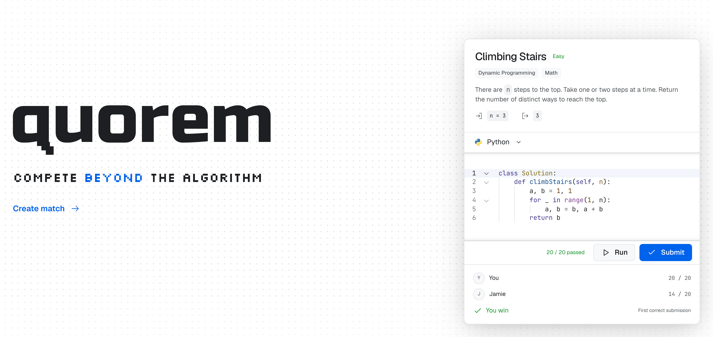
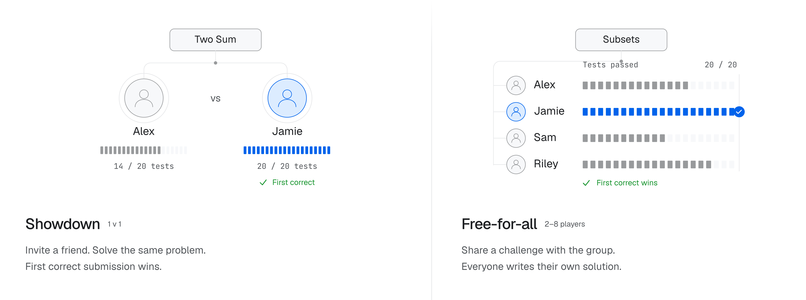

<a id="readme-top"></a>

<div align="center">

<picture>
  <source media="(prefers-color-scheme: dark)" srcset="apps/web/public/favicon-dark.svg" />
  
</picture>

<h1>Quorem</h1>

<strong>Compete beyond the algorithm.</strong>

Private coding matches, solo practice, and collaborative interviews.

<p>
  <a href="https://quorem.app"><strong>Try Quorem</strong></a> ·
  <a href="https://quorem.app/practice">Browse problems</a> ·
  <a href="https://github.com/ethan-ngai/quorem/issues">Report a bug</a>
</p>

<p>
  
  
  
  <a href="LICENSE"></a>
</p>

</div>

<p align="center">
  <a href="https://quorem.app">
    <picture>
      <source media="(prefers-color-scheme: dark)" srcset="docs/images/readme/hero-dark.webp" />
      <source media="(prefers-color-scheme: light)" srcset="docs/images/readme/hero-light.webp" />
      
    </picture>
  </a>
</p>

## Contents

- [About the project](#about-the-project)
- [Features](#features)
- [Run locally](#run-locally)
- [Documentation](#documentation)
- [Contributing](#contributing)
- [License](#license)

## About the project

Quorem brings coding practice and private competition into one workspace. Pick a problem, invite a friend or group, and race for the first correct submission. Everyone writes their own solution; the match tracks results without sharing opponents' code.

The repository also includes solo practice, collaborative interviews, question authoring, and isolated judging for **Python, Java, TypeScript, OCaml, and PostgreSQL**.

Start at **[quorem.app](https://quorem.app)**. Create an account to run and submit in solo practice, or [create a private match](https://quorem.app/practice?create=match).

## Features

**Private matches.** Showdown pairs two players; Free-for-all supports 2–8. Choose a problem or filtered random selection, set the duration and lobby rules, and share an invitation. The first correct submission wins. At the deadline, passed tests decide the result; ties draw.

<p align="center">
  <picture>
    <source media="(prefers-color-scheme: dark)" srcset="docs/images/readme/match-modes-dark.webp" />
    <source media="(prefers-color-scheme: light)" srcset="docs/images/readme/match-modes-light.webp" />
    
  </picture>
</p>

- **Solo practice:** filter by difficulty, topics, companies and question type. Solve in Python, Java, TypeScript, OCaml or PostgreSQL.
- **Editor:** run custom cases, inspect results beside your code, and retain browser drafts. Light and dark themes supported.
- **Interviews:** collaborate in a shared editor, run solutions, and control stage advancement. Interviewer-private tests stay private.
- **Odyssey:** solve progressive questions that add requirements and methods across stages.
- **Question authoring:** create coding or SQL questions with structured signatures, examples, hidden tests and editorials. Publish versioned questions to global or private libraries.
- **Judging:** execute submissions in bounded sandboxes. SQL cases use isolated PostgreSQL instances and a restricted query role.

Hosting, guest admission and authoring depend on [account permissions](docs/implementation/guest-access.md). Images are illustrative previews from [quorem.app](https://quorem.app).

## Run locally

Requires **[Vite+](https://viteplus.dev) (`vp`), Node.js 24.21.0, Python 3, and Docker with Compose**. Keep Docker running. Local development uses fixtures and requires no cloud provider credentials.

```sh
git clone https://github.com/ethan-ngai/quorem.git
cd quorem
make install
make dev
```

Open **[http://localhost:5173](http://localhost:5173)**. The supervisor builds judge images, starts local services, applies migrations, seeds problems and accounts, and runs the marketing site and workspace with live HMR. The first startup includes container builds. Native development uses `quorem_hono_dev`; the previous `quorem` database is preserved. API and Better Auth share the Hono process.

Sign in as `alice` (admin) or `bob` using the generated `AUTH_SEED_PASSWORD` in ignored `.local/auth-preview.json`. Keep this file private; these accounts are local fixtures.

| Command | Purpose |
| --- | --- |
| `make dev` | Run the integrated local stack with live HMR |
| `vp -C apps/web dev` | Run workspace Vite against existing local services |
| `vp -C apps/marketing run dev` | Run marketing Astro with live HMR |
| `make check` | Check types, contracts and tests |
| `make build` | Build the site and check native services |
| `make seed` | Seed the local problem catalog |
| `make reset` | Recreate only the native local database and reseed |

PostgreSQL integration tests require `QUOREM_TEST_DATABASE_URL` pointing to a **separate disposable database**. Tests truncate data; never point them at your running development database.

## Documentation

| Area | Read more |
| --- | --- |
| Architecture | [System design](docs/plans/architecture.md) · [Provider adapters](docs/implementation/platform-adapters.md) |
| Gameplay | [Match modes](docs/implementation/match-modes.md) · [Guest access](docs/implementation/guest-access.md) |
| Editor and questions | [Languages](docs/implementation/multiple-languages.md) · [SQL](docs/implementation/sql-problems.md) · [Authoring](docs/implementation/question-authoring.md) |
| Data and deployment | [Database](docs/implementation/database.md) · [Production](docs/implementation/production.md) · [Deployment workflows](deploy/README.md) |
| Design and plans | [Design system](DESIGN.md) · [Plans](docs/plans/README.md) · [Open issues](https://github.com/ethan-ngai/quorem/issues) |

## Contributing

[Open an issue](https://github.com/ethan-ngai/quorem/issues) for bugs or feature requests. Include reproduction steps and expected behavior; omit credentials and private code.

Read [CONTRIBUTING.md](CONTRIBUTING.md) and [AGENTS.md](AGENTS.md) before making changes. Use `vp` for TypeScript tooling, follow [DESIGN.md](DESIGN.md) for UI work, and target `dev`.

## License

Licensed under the **[GNU Affero General Public License v3.0](LICENSE)**.
