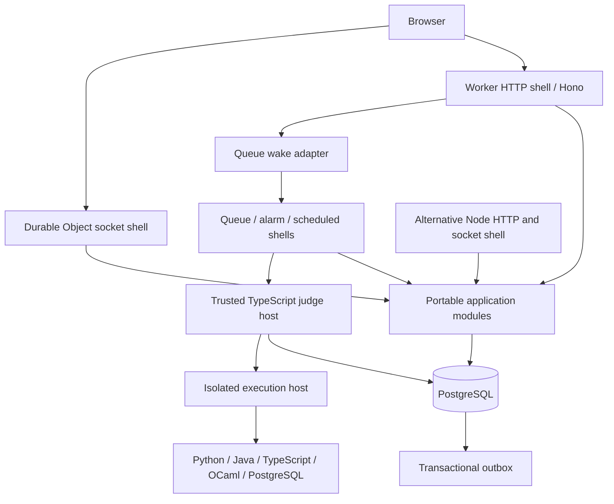

# Architecture and module boundaries

[Plan index](README.md)



Arrows into PostgreSQL use focused repositories; the diagram does not grant every module unrestricted database access. Browser sockets never receive hidden fixtures or judge credentials.

Proposed layout, kept within existing owners:

```text
apps/api/src/
  app.ts                          Hono composition; no server startup
  http/                           request middleware, response/error mapping
  modules/
    identity/ access/ problems/ workspace/ judging/ matches/ interviews/
      routes.ts                   thin Hono subapplication
      service.ts                  use cases; split by cohesive behavior as needed
      model.ts                    values and pure rules where needed
      ports.ts                    consumer-owned semantic interfaces
    events/                       outbox dispatch and safe notice contracts
  adapters/
    postgres/                     Drizzle command/query repositories and locks
    cloudflare/                   queue, socket, scheduling, objects, mail
    aws/                          supported capability adapters
    local/                        fixture/test delivery adapters
  runtime/
    cloudflare/                   fetch, queue, scheduled, DO entrypoints
    node/                         Hono server, sockets, scheduler/listener host
  cli/                            migrations, seeds, maintenance
apps/auth/src/                    existing Better Auth owner; extract factories
apps/runner/src/                  trusted Node supervisor and sandbox adapters
apps/language/src/                consolidated TypeScript gateway
packages/contracts/               existing public API/event/question owner
packages/questions/               canonical question semantics shared by API/judge/tools
packages/execution/               private job, runtime, frame, checkpoint codecs
packages/database/                backend-only Drizzle schemas and connection/transaction primitives
```

Create a file/layer only when it has responsibility. Do not manufacture a model/service/repository class for every route. Keep app-specific modules in `apps/api`; extract `packages/execution` because API, judge and tooling actually share it. Public contracts must not export private execution types.

The Node shell is the runnable portability proof, not a second product implementation. Existing AWS capability adapters remain supported through tests; no AWS infrastructure rollout is required for this migration. A new cloud/runtime adapter beyond Node is separate scope.

## Dependency direction

HTTP/socket/runtime shells -> application commands and queries -> consumer-owned ports. Adapters implement those ports. Pure question/execution rules depend on values/codecs only. Backend database code can depend on Drizzle; domains and browser contracts cannot.

Use explicit module exports. Cross-domain collaboration calls another module's application contract, never its repository or tables. Transaction-spanning use cases have one named owning command with transaction-bound collaborators; never two service transactions pretending to be atomic. No generic repository, service locator or event-driven replacement for a required synchronous invariant.

Canonical packages have actual shared consumers: questions (API, judge, tools), execution (API, judge), database (API, auth, judge). Keep HTTP, policies and DTO projections in their domain. The database package exposes separate product/auth/schema/core entrypoints, not one barrel that loads every adapter.

Future extensions compose around query/retrieval contracts; they cannot alter command authority. See [canonical owners](canonical-owners.md), [primitives](primitives.md), [extension seams](extensions.md).
