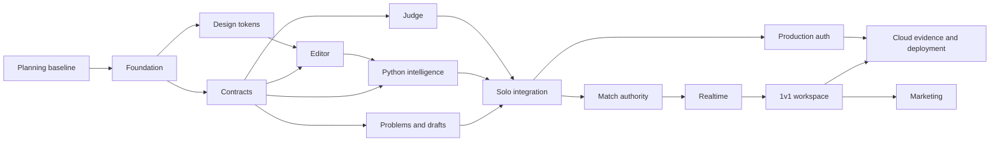

# Agent work plan

Each ticket includes problem/outcome, owned paths, dependencies, frozen contracts, checks, non-goals, and blocking decisions. Coordinator owns shared contract changes; dependent agents request changes before editing another domain. Worktrees per ticket; Conventional Commits; PR stacks follow dependency order. Do not parallelize unresolved shared interfaces.

| Ticket | Domain / owned paths | Depends on | Done when |
| --- | --- | --- | --- |
| Q0 | Planning: root policy, docs/plans, docs/adr | Confirmed choices + delegated defaults | Reviewable baseline, tickets, evidence gates |
| Q1 | Foundation: root tooling, local orchestration | Q0 structural choices | `vp`/Go checks; reproducible no-AWS startup |
| Q2 | Design: DESIGN.md, packages/ui | Q1; confirmed visual direction | Token CSS, theme/accessibility contract; no unrelated pages |
| Q3 | Contracts: packages/contracts, internal/execution | Q1; contracts.md | OpenAPI/events, generated types, runtime/public stubs frozen |
| Q4 | Problems + drafts: apps/api, migrations, fixtures | Q1,Q3 | Six seeds, owner drafts, concurrent-save/recovery tests |
| Q5 | Editor: apps/web | Q1,Q2,Q3 | Mock service workspace; buffer/undo/panes/states verified |
| Q5a | Python intelligence: language adapter/extensions | Q1,Q3; Q5 seam for integration | Four intelligence features, typed harness parity, lifecycle/latency/isolation/stale-response proof |
| Q6 | Judge: apps/runner, judging module | Q1,Q3 | Python execution, fenced leases, full-suite partial counts, redaction/isolation checks |
| Q7 | Solo integration: cross-domain coordinated fixes | Q4,Q5,Q5a,Q6 | Required Python intelligence + real Run/Submit + reload persistence; E2E acceptance |
| Q8 | Matches: apps/api match module | Q7; confirmed match rules | Transactional lifecycle, deadline/forfeit/no-contest/expiry proof |
| Q9 | Realtime: local adapters + browser transport | Q3,Q8 | Authorized delivery, dedup/resync; restart tests |
| Q10 | 1v1 workspace: apps/web match flow | Q8,Q9 | Two-browser E2E and deadline/disconnect races |
| QA | Production identity: apps/auth, identity adapters | Q7,Q3 | Better Auth/Cognito integration against mocks; verification/session/linking tests |
| Q11 | Cloud: infra/terraform, cloud adapters, CI | Q10,QA; cost/capability evidence | Cloud parity, isolation, load/cost, restore/rollback proof |
| Q12 | Marketing: apps/marketing | Q10; editor/1v1 complete | Astro content/tokens/routes; factual copy |

Q4/Q5/Q6 and Q5a capability/adapter work can run in parallel after contracts freeze; Q5a editor integration waits for Q5 seam. Q8/Q9 planning may proceed during Q7; implementation follows frozen lifecycle/events. Q11 cost/security design and Terraform source can start earlier without credentials; provisioning follows local integration and evidence gates. Future features remain backlog, not active work.

## Handoff and collision rules

Every ticket uses the immutable planning PR/commit as context plus its linked domain specs. The ticket owner lists changed paths and actual checks; does not expand scope or silently rewrite another owner's interfaces. Coordinator resolves schema/migration/shared-root changes first.

- Q1 owns root manifests/lockfile/Makefile, compose configuration, `.env.example`, toolchain pins and initial CI only. Create app skeletons; no application behavior.
- Q2 owns root DESIGN.md and `packages/ui/src/tokens.css`/theme primitives. UI implementation uses design-system skill; no marketing or generic component library expansion.
- Q3 owns `packages/contracts/{openapi,events,fixtures}`, generated client/type code and `internal/execution` contracts/public harness declarations. Owns contract changes throughout the stack. Consumers never hand-edit generated files.
- Q4 owns `apps/api/internal/{problems,workspace}`, corresponding `adapters/postgres` repositories, migrations 001–019, and `fixtures/problems`. Schema/seed validation and recovery/version tests required. No judge/match logic.
- Q5 owns `apps/web/src/{routes/workspace,features/editor,features/results}` and PythonEditor lifecycle. Fixtures first; then consume clients. Q5a injects extensions through frozen seam without owning this lifecycle.
- Q5a owns `apps/api/internal/adapters/language`, `apps/language/` orchestration and `apps/web/src/features/intelligence`. Spike records engine/version/capability evidence; public stubs from Q3. No format/navigation/refactor scope.
- Q6 owns `apps/runner`, `apps/api/internal/judging`, queue/execution adapters, migrations 020–039. Q4 supplies fixture suites; Q6 validates reference/incorrect/isolation outcomes. Trusted comparator outside sandbox.
- Q7 owns `tests/e2e/solo` and integration coordination; domain fixes return to owning agent. Check actual browser/console, service restarts, privacy and all six problems; do not add new pages.
- Q8 owns `apps/api/internal/matches`, migrations 040–059; locks/admission/time/score/outbox transactions, expiry/no-contest reconciliation. Contract fields remain Q3-owned.
- Q9 owns `apps/api/internal/realtime`, local realtime adapter and `apps/web/src/features/realtime`; native WebSocket authorization, dedup/resync and polling fallback. No match rules in transport.
- Q10 owns `apps/web/src/{routes/match,features/match}` and `tests/e2e/multiplayer`; separate match workspaces/private source. No public matchmaking/social pages.
- QA owns `apps/auth`, `apps/api/internal/identity`, auth migrations/schema and auth integration tests. Mock flows first; no duplicate password database or global implicit account linking.
- Q11 owns `infra/terraform`, cloud-specific adapters and `.github/workflows` deployment jobs. Shared domain code unchanged except reviewed adapter seams. Provision only after cost/security gate; evidence distinguishes static/local/cloud checks.
- Q12 owns `apps/marketing` only, consumes shared tokens; factual feature copy reflects delivered behavior. No fabricated metrics or unfinished feature promises.

## Required ticket payload

Each GitHub issue links this ownership row, relevant domain specs, predecessor issues, and its done condition from the table. Agent receives: exact branch/worktree, allowed paths, frozen schema revision, commands/evidence required, non-goals, and escalation rule. Start with `docs:`, `feat:`, `fix:` or `test:` Conventional Commit subjects. Stack dependent PRs on predecessor branches and retarget after merge; independent domains branch from the frozen contract baseline. One agent per ownership group; coordinator alone edits shared root/contract files during parallel work.

## Ticket publication

Planning parent links concise domain issues and dependency checklists; no native sub-issues. Tickets describe confirmed scope/defaults and empirical gates, not speculative features. PR descriptions lead with behavior/verification; maintain updated stack dependencies after changes.

## Acceptance by milestone

- Solo: confirmed Python harness, CodeMirror 6 + required Python intelligence, editor design, owner persistence, real judging, retries/redaction, no live AWS.
- 1v1: confirmed matchmaking/rules, isolation of identities, authoritative results, recoverable realtime, two-browser proof.
- Public: validated execution isolation, abuse limits, production identity, cost envelope, migrations/rollback, actual AWS checks.
